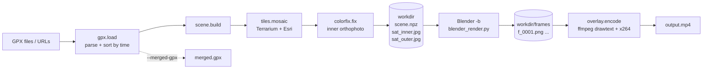
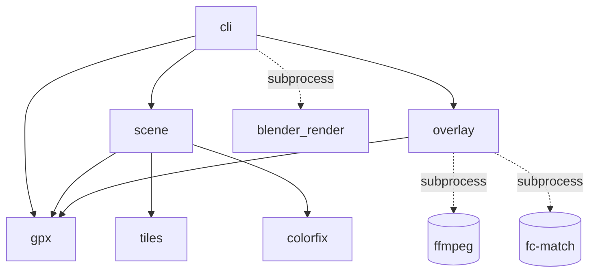
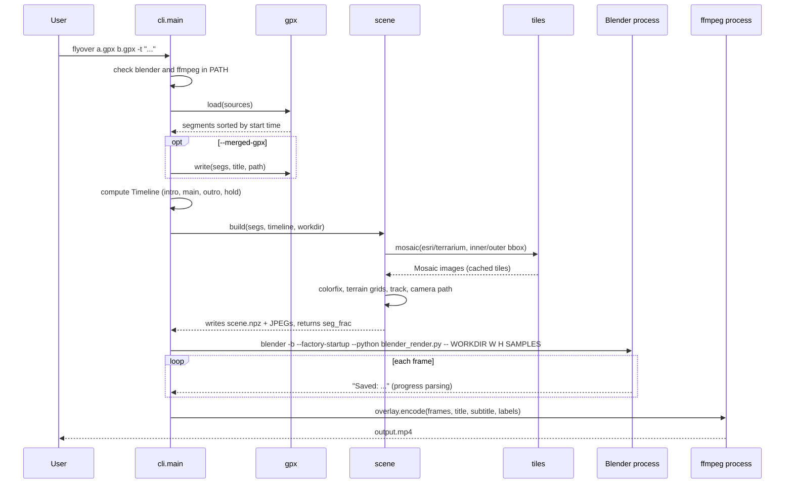
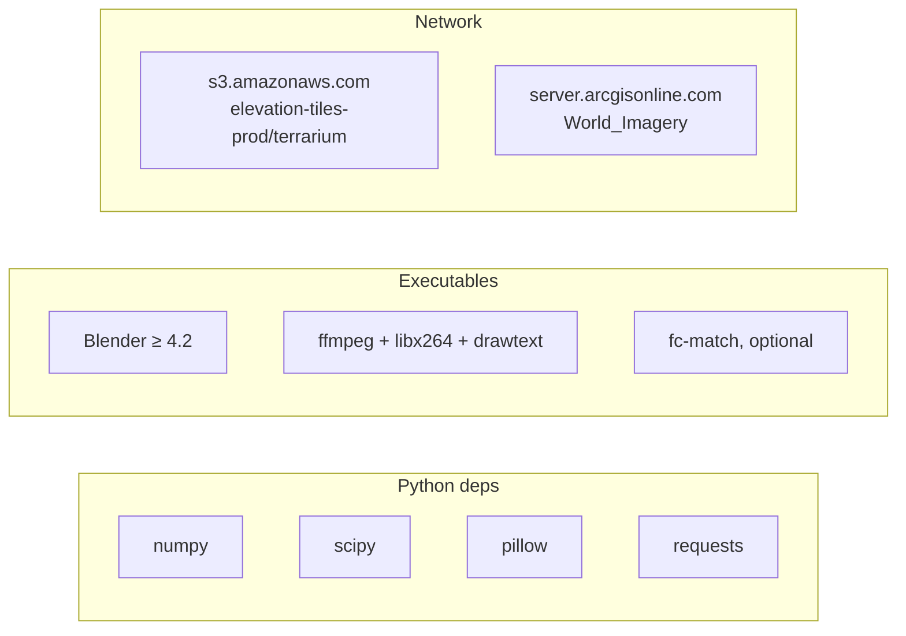

# Architecture

`gpx-flyover` is a small Python CLI that orchestrates three external worlds:

- **web tile servers** (elevation and imagery), downloaded and cached locally;
- **Blender**, run headless as a separate process to render PNG frames;
- **ffmpeg**, run as a separate process to add text overlays and encode H.264.

The Python package never imports `bpy`. Everything Blender needs is serialized to a work
directory (`scene.npz` + two JPEG orthophotos), and a standalone script
(`blender_render.py`) is executed *inside* Blender to rebuild the scene and render it.

## Pipeline



## Modules

| Module | Responsibility | Runs in |
|---|---|---|
| `cli.py` | Argument parsing, timeline sizing, process orchestration (Blender, ffmpeg), work directory lifecycle, `--reencode` | host Python |
| `gpx.py` | GPX parsing (files or HTTP URLs), segment sorting, haversine length, merged GPX writer | host Python |
| `tiles.py` | Web Mercator math, tile download with on-disk cache and retries, mosaic assembly, Terrarium decoding, zoom selection | host Python |
| `colorfix.py` | Detection and correction of pale tile blocks in Esri imagery | host Python |
| `scene.py` | Local metric frame, terrain grids, track resampling, camera path, intro/outro/hold animation, writes `scene.npz` | host Python |
| `overlay.py` | Date/distance formatting (Italian), stage labels, ffmpeg filter graph and final encode | host Python |
| `blender_render.py` | Builds meshes, materials, lights, camera keyframes from `scene.npz`, renders PNG frames with EEVEE | **Blender's Python** |



`blender_render.py` has no Python import relation with the rest of the package: the only
contract between the two sides is the content of the work directory.

## Execution sequence



## Work directory

By default a temporary directory (`flyover-*`) is created and deleted at the end. With
`--workdir DIR` it is kept, which enables `--reencode` and inspection of intermediate data.

```
DIR/
├── scene.npz        # all numeric scene data (see below)
├── sat_inner.jpg    # high-res orthophoto, color-corrected (quality 92)
├── sat_outer.jpg    # low-res orthophoto for the horizon
├── frames/
│   ├── f_0001.png   # rendered frames, 1-based, written by Blender
│   └── ...
└── txt/             # text files used by ffmpeg drawtext (title, sub, stageN, att)
```

When a new render starts with `--workdir`, `frames/` is wiped first; the rest is overwritten.

### `scene.npz` contract

| Key | Shape | Meaning |
|---|---|---|
| `Z` | `(R, C)` float32 | Inner terrain heights (m), row 0 = north edge |
| `ext` | `(4,)` | Inner extent in local metres: `x0, x1, y0, y1` (`y0` = north edge) |
| `Zo` | `(640, 640)` float32 | Outer terrain heights (m) |
| `exto` | `(4,)` | Outer extent, same convention as `ext` |
| `track` | `(N, 3)` | Track polyline in local metres, resampled every 4 m, lifted 3 m above ground |
| `breaks` | `(P,)` int | Index in `track` of the first point of each piece (see [internals](internals.md#track)) |
| `cam` | `(F, 3)` | Camera position per frame |
| `look` | `(F, 3)` | Camera target per frame |
| `reveal` | `(F,)` | Fraction of the track drawn at each frame, 0..1 |
| `fps` | scalar | Frames per second |

`F` equals `Timeline.frames`. Both terrain meshes are UV-mapped 0..1 over their extent, so the
JPEG orthophotos are draped exactly on the matching area.

## External dependencies



Network access is needed only for tiles not yet in the cache and for GPX URLs.
