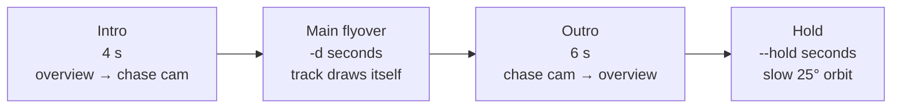

# CLI reference

```
flyover [-h] [-o OUTPUT] [-t TITLE] [-d DURATION] [--hold HOLD] [--fps FPS]
        [--preview] [--crf CRF] [--reencode] [--merged-gpx MERGED_GPX]
        [--workdir WORKDIR] [--no-colorfix] [--tz TZ] [--blender BLENDER]
        gpx [gpx ...]
```

The built-in `--help` text is in Italian; this page is the English reference.

## Inputs

### `gpx` (positional, one or more)

Local paths (`~` is expanded) or `http://` / `https://` URLs pointing directly to a GPX file.

- Every `<trkseg>` of every `<trk>` becomes a **segment**. Segments with fewer than 2 points are skipped.
- Segment name = the `<trk><name>`, with a trailing ` - Wikiloc` removed; if missing, the file stem.
- Segments are sorted by the timestamp of their first timed point. Segments with no timestamps
  keep their command-line order and are placed **after** all timed ones.
- Consecutive segments whose gap (end of one to start of the next) is at most `--max-gap` are
  joined into one continuous line. A larger gap starts a new **piece**: no line is drawn across
  the gap and the camera cuts straight to the start of the next piece. The gap does not count
  towards the flyover time.

## Options

| Option | Default | Details |
|---|---|---|
| `-t, --title` | first segment's name, else `Sorvolo` | Shown in the opening and in the end card. |
| `-o, --output` | `<slug(title)>.mp4` in the current directory | Slug = lowercase, non-alphanumerics replaced by `-`. |
| `-d, --duration` | `3 × km`, clamped to 30-120 s | Length of the main flyover only. |
| `--hold` | `8` | Seconds of slow orbit (25°) over the overview at the end. `0` disables it. |
| `--fps` | `30` (`15` with `--preview`) | Frame count, and therefore render time, scales linearly. |
| `--preview` | off | 960×540, 15 fps, 4 EEVEE samples (vs 1920×1080, 30 fps, 16 samples). |
| `--crf` | `26` | x264 CRF with preset `slow`. Lower = better and larger. |
| `--reencode` | off | Skip download and render, encode again from `--workdir/frames`. |
| `--max-gap` | `500` | Metres between consecutive segments above which the line is broken and the camera cuts to the next segment. A huge value restores the old behaviour (one continuous line). |
| `--merged-gpx FILE` | - | Writes one GPX 1.1 file with a single `<trk>` named after the title and one `<trkseg>` per segment. Original segment names are not preserved. |
| `--workdir DIR` | temp dir, deleted | Keeps intermediate files. See [architecture](architecture.md#work-directory). |
| `--no-colorfix` | off | Skips [color correction](internals.md#color-correction). |
| `--tz` | `Europe/Rome` | IANA zone used to compute calendar days for the subtitle and "Giorno N" labels. |
| `--blender` | `blender` in `PATH` | Path to the Blender executable. |

## Video timeline

The video is a sequence of four phases. Lengths in frames are `round(seconds × fps)`.



Overlay timing on top of these phases:

| Text element | Visible from | Visible until |
|---|---|---|
| Centered title | 0.3 s | 5.5 s |
| Centered subtitle | 0.8 s | 5.5 s |
| Stage labels (bottom-left) | max(5 s, when the segment starts drawing) | when the next label starts, or end of main flyover |
| End card title (top) | end of main flyover + 0.5 s | end of video |
| End card subtitle | end of main flyover + 0.9 s | end of video |
| Attribution (bottom-right) | 0 s | end of video |

Text fades in over 0.6 s and, when it ends before the video does, fades out over 0.6 s. The attribution has no fade of its own.

The whole video fades in from black (0.8 s) and out to black (0.8 s).

## On-screen text

Generated text is in Italian:

| Element | Example |
|---|---|
| Subtitle | `10-11 ottobre 2026  ·  25,4 km` |
| Stage label, single day | `Giro del lago` |
| Stage label, multi-day | `Giorno 2  ·  Discesa` |
| Attribution | `Immagini: Esri World Imagery  ·  Quote: Mapzen Terrarium (AWS)` |

Dates are formatted as compact ranges (`10 ottobre 2026`, `10-11 ottobre 2026`,
`30 settembre - 1 ottobre 2026`, cross-year ranges with both years). Distances use a decimal comma.

Stage labels: consecutive segments with the same name **and** the same day are merged into one
label. Labels shorter than 1.5 s or with empty text are dropped.

## Recipes

Quick framing check before a long render:

```
flyover track.gpx --preview -o check.mp4
```

Render once, then try different encodings without re-rendering:

```
flyover a.gpx b.gpx --workdir work/ -d 80
flyover a.gpx b.gpx --workdir work/ -d 80 --reencode --crf 20 -o hq.mp4
```

`--reencode` validates that the number of PNGs in `work/frames` equals the frame count implied
by `-d`, `--fps` and `--hold` (and `--preview`, which changes the default fps). It still needs the
GPX inputs, because title, subtitle and labels are recomputed from them. The output height (and
thus font scale) is taken from the first frame.

Shorter render with lower frame rate:

```
flyover track.gpx --fps 24 --hold 0
```

Merge several recordings into one GPX: the merged file is written before any download or
render, so you can stop with `Ctrl+C` once `GPX unito: ...` is printed.

```
flyover day1.gpx day2.gpx -t "Two days" --merged-gpx merged.gpx
```

## Exit conditions

| Message | Cause |
|---|---|
| `Blender non trovato...` | `--blender` not executable / not in `PATH` |
| `ffmpeg non trovato` | ffmpeg not in `PATH` |
| `Nessun punto traccia trovato...` (ValueError) | no segment with ≥ 2 points in any input |
| `Download fallito per ...` (RuntimeError) | a tile failed 4 times in a row |
| `Blender è terminato con errore (n/N fotogrammi)` | Blender exited non-zero or rendered fewer frames than expected; the last 30 lines of its output are printed |
| `--reencode: attesi N fotogrammi...` | frame count mismatch, see recipe above |
