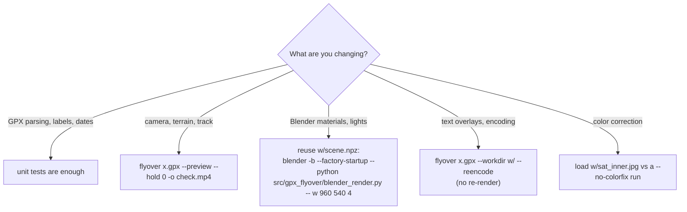

# Development

## Setup

```
uv sync            # creates .venv with runtime + dev dependencies (pytest)
uv run flyover -h  # run the CLI from the source tree
uv run pytest      # run the test suite
```

Blender and ffmpeg are only needed for end-to-end runs, not for the tests.

## Layout

```
src/gpx_flyover/
├── cli.py              # entry point (flyover = gpx_flyover.cli:main)
├── gpx.py
├── tiles.py
├── colorfix.py
├── scene.py
├── overlay.py
└── blender_render.py   # executed by Blender, not imported
tests/
├── test_gpx.py
├── test_overlay.py
└── test_colorfix.py
```

The package is built with hatchling; `blender_render.py` ships inside the wheel and is located at
runtime with `Path(__file__).with_name("blender_render.py")`.

## Tests

| File | Covers |
|---|---|
| `test_gpx.py` | Wikiloc suffix stripping, segment ordering by start time, merged GPX round-trip, haversine length |
| `test_overlay.py` | Italian date ranges, decimal comma, stage label merging and day numbering |
| `test_colorfix.py` | Pale block detection vs isolated tiles, water exclusion |

Tests build GPX documents in memory (`tests.test_gpx.make_gpx`) and need no network.
Not covered by tests: tile download, scene geometry and camera path, Blender script, ffmpeg
filter graph. Changes there should be verified with a `--preview` run.

## Working on specific stages



Running `blender_render.py` directly against an existing work directory is the fastest loop for
Blender-side changes: the scene data is already there and no tile is downloaded. Open Blender
without `-b` and run the script from the Text editor to inspect the scene interactively
(remove the final `render` call first).

## Conventions

- Source comments, docstrings, `--help` and user-facing messages are in Italian; on-screen
  video text is Italian by design.
- Status output goes to **stderr**; nothing is printed to stdout.
- Long numeric lines are kept compact with `# fmt: skip` where alignment matters.
- Commits follow Conventional Commits (`feat:`, `fix:`, ...).

## Troubleshooting

| Symptom | Likely cause / fix |
|---|---|
| `Blender non trovato` | Install Blender ≥ 4.2 or pass `--blender /path/to/blender` |
| Blender fails with `ModuleNotFoundError: numpy` | Distro-packaged Blender using system Python without numpy; use the official build or install numpy for that Python |
| `drawtext` filter not found | ffmpeg built without libfreetype; install a full build |
| Wrong or ugly font | Inter not installed; check `fc-match Inter:bold` |
| Bright rectangular patches on the ground | Mixed-source imagery; color correction did not catch them (try defaults) or caught the wrong areas (try `--no-colorfix`) |
| Straight line crossing the map | Two segments far apart; they are concatenated without a gap |
| Track appears in the wrong order | Segments without timestamps go last; add times or pass files in order without times |
| "Giorno N" labels split a day oddly | Day boundaries depend on `--tz` |
| Very blurry ground on long routes | `pick_zoom` lowered the zoom to keep the mosaic within its pixel budget; increase the `max_px` values in `scene.build` at the cost of memory |
| `Download fallito` | Network error or tile server throttling; re-run, cached tiles are reused |
| `--reencode: attesi N fotogrammi` | Use exactly the same `-d`, `--fps`, `--hold`, `--preview` as the render |

## Known limitations

- **Single linear track.** All segments are concatenated into one polyline; there is no
  per-segment styling and no gap handling.
- **Italian only.** On-screen text, month names and number formatting are hard-coded.
- **Flat projection.** A single metres-per-unit factor is used for the whole scene; very long
  north-south routes will be slightly distorted.
- **Imagery terms.** Esri World Imagery is used for personal purposes with attribution; check the
  provider terms before publishing videos commercially.
- **Render cost.** About 1.8 s/frame at 1080p on an 8-core laptop; a 90 s video at 30 fps
  (≈ 3500 frames including intro/outro/hold) takes over an hour. Use `--preview`, `--fps 24`,
  or `--hold 0` to iterate.
