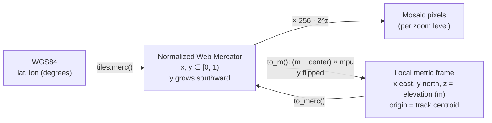
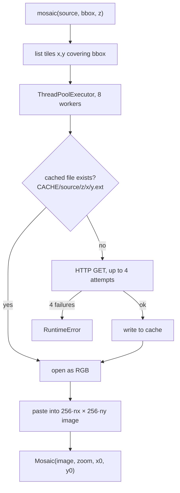
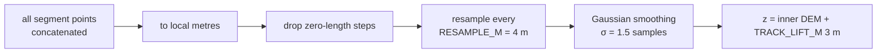
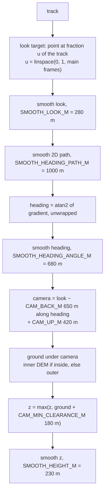
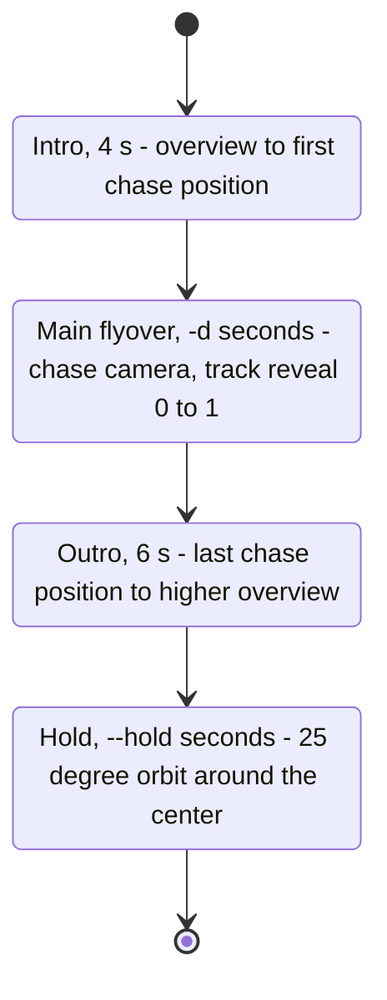
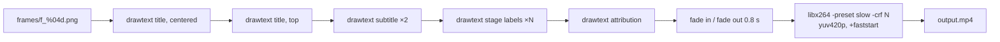
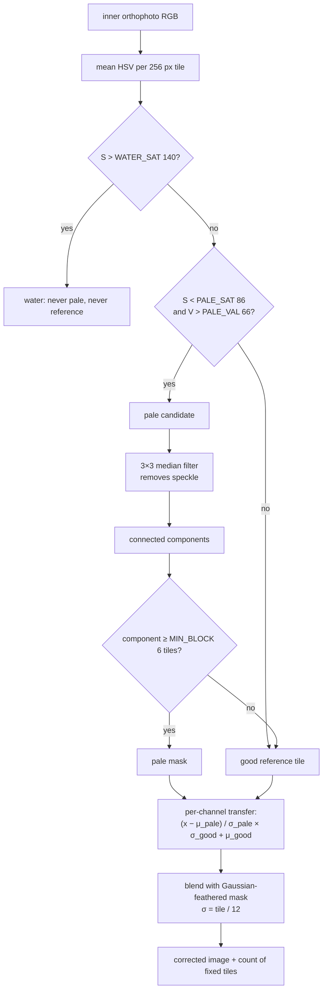

# Internals

This page explains the numeric choices behind each stage. Constants are named as in the source,
so they can be tuned in place.

## Coordinate systems

Three coordinate systems are used, converted in `tiles.py` and `scene.py`.



- `mpu` (metres per Mercator unit) = `EARTH_CIRC × cos(mean latitude)`. A single scale factor
  is used for the whole scene, which is accurate for areas of a few tens of km; distortion grows
  with north-south extent.
- The local frame is what Blender sees: 1 Blender unit = 1 metre.

## Tiles and terrain

### Areas and zoom levels

Two bounding boxes are built around the track:

| Area | Padding | Imagery (Esri) | Elevation (Terrarium) | Purpose |
|---|---|---|---|---|
| Inner | `INNER_PAD_KM` = 2 km | ≤ 12000 px/side, z ≤ 17 | ≤ 4096 px/side, z ≤ 15 | detailed terrain under the camera |
| Outer | `OUTER_PAD_KM` = 20 km | ≤ 8000 px/side, z ≤ 14 | ≤ 2048 px/side, z ≤ 12 | horizon |

`tiles.pick_zoom(bbox, max_px, z_max, z_min=8)` picks the highest zoom whose mosaic fits in
`max_px` on its longest side. Long tracks therefore get lower zoom automatically, which keeps
memory bounded but reduces ground detail.

### Download and cache



- Cache root: `$XDG_CACHE_HOME/gpx-flyover/tiles`, default `~/.cache/gpx-flyover/tiles`.
  It is never pruned; delete it manually if it grows too large.
- There is no back-off between retries and no rate limiting beyond the 8-thread pool.
- `Image.MAX_IMAGE_PIXELS` is disabled because mosaics legitimately exceed Pillow's default limit.

### Terrarium decoding

Terrarium tiles encode elevation in RGB:

```
height_m = R × 256 + G + B / 256 − 32768
```

`scene._sampler()` wraps a decoded mosaic into a bilinear sampler (`map_coordinates`, order 1,
`mode="nearest"`) that takes Mercator coordinates and returns metres.

### Terrain meshes

- **Inner grid**: 700 columns, rows proportional to the aspect ratio, covering the inner
  *imagery* mosaic extent, heights sampled from the inner DEM.
- **Outer grid**: 640 × 640 over the outer imagery extent. Inside the inner area it samples the
  **inner** DEM to avoid visible steps where the two meshes overlap, then the whole outer mesh is
  lowered by 4 m so the inner mesh always wins the depth test.

## Track



GPX elevation is **ignored**: the track is draped on the DEM, so it never floats or sinks because of
barometer/GPS altitude errors. Resampling is done on 2D (plan) distance.

## Camera

The camera path is computed for the main flyover in frame space, with all smoothing radii
expressed in metres of track and converted to frames (`sig(m) = max(1, m × frames_per_metre)`),
so the motion feels the same regardless of track length or fps.



Heavier smoothing of the heading than of the target means the camera swings wide on switchbacks
instead of following every hairpin, while the target stays on the track.

### Intro, outro and hold

An overview point is computed from the track:

- `ctr` = mean of the track (x, y, z)
- `span` = largest horizontal extent of the track
- `dist = max(2600 m, 1.1 × span)`



- Intro start: `ctr + (−dist·cos θ₀, −dist·sin θ₀, dist)`, where θ₀ is the initial heading, so the
  first shot already looks in the direction of travel.
- Outro end: `1.08 × dist` back and `1.15 × dist` up along the final heading.
- All transitions use a cosine ease-in-out (`_ease`).
- `reveal` is 0 during the intro, linear 0 → 1 during the main flyover, 1 afterwards.

## Blender scene (`blender_render.py`)

Runs as `blender -b --factory-startup --python blender_render.py -- WORKDIR WIDTH HEIGHT SAMPLES`
on an empty factory scene.

| Object | Construction |
|---|---|
| `terrain`, `outer` | Grid meshes built with `foreach_set` from `Z`/`Zo`, smooth shading, UV 0..1, Principled BSDF (roughness 1) with the orthophoto, texture extension `EXTEND` |
| `track` | 3D POLY curve, bevel depth 4.5 m, emissive orange (strength 2) |
| `marker` | UV sphere r = 12 m, emissive yellow (strength 4), 6 m above the drawing head |
| `sun` | Sun light, energy 4, angle 2°, rotation (50°, 0, 150°) |
| `world` | Flat sky color (0.55, 0.68, 0.85), strength 0.9 |
| `cam` | 24 mm lens, clip 5 m - 120 km, keyframed location and rotation (`to_track_quat("-Z", "Y")`) |

### Track reveal

The progressive drawing animates `bevel_factor_end` with `bevel_factor_mapping_end = "SPLINE"`.
That factor is proportional to **3D** curve length, whereas `reveal` is a fraction of point
**index** (constant 4 m plan spacing). The script converts index → cumulative 3D distance so that
the line's head stays exactly under the marker on steep climbs.

### Render settings

- Engine `BLENDER_EEVEE` (falls back to `BLENDER_EEVEE_NEXT` on 4.2-4.x).
- TAA samples: 16, or 4 with `--preview`.
- View transform `Standard` (not Filmic/AgX), to keep orthophoto colors close to the source.
- Output: PNG to `WORKDIR/frames/f_####.png`, frames 1..F.

`cli._render` reads Blender's stdout and counts `Saved:` lines for the progress indicator; on TTY
it updates a single line, otherwise it prints roughly every 5%.

## Overlays and encoding (`overlay.py`)

ffmpeg is called once with an image-sequence input and a chain of `drawtext` filters:



- Text is passed through files in `WORKDIR/txt/` (`textfile=`) to avoid escaping issues with
  quotes, colons and accents in titles.
- Font sizes and offsets are defined for 1080p and multiplied by `height / 1080`.
- Fonts: `fc-match Inter:bold` and `Inter:medium`; if `fc-match` is unavailable, `DejaVuSans.ttf`.
- Fades are implemented as an `alpha` expression per filter (`_alpha(a, b)`), 0.6 s each side.

## Color correction

Esri World Imagery is a mosaic of providers. In some regions (notably Switzerland, swisstopo)
the imagery is lighter and less saturated than neighbouring sources, producing visible
tile-aligned blocks. `colorfix.fix` corrects the **inner** orthophoto only.



Notes:

- The `V > PALE_VAL` condition excludes dark forest in shadow, which is also low-saturation.
- Statistics are global: one mean/std pair for all pale pixels and one for all good pixels. Pale
  blocks with very different content (e.g. snow vs meadows) are corrected with the same transform.
- If no tile is pale, or no tile is good, the image is returned unchanged.
- Disable with `--no-colorfix` when the heuristic misfires (e.g. large snowfields or dry
  grassland detected as pale).
